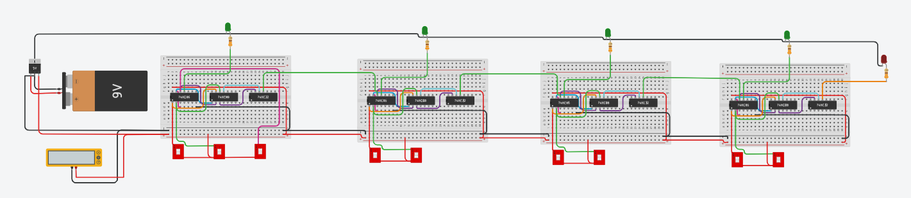
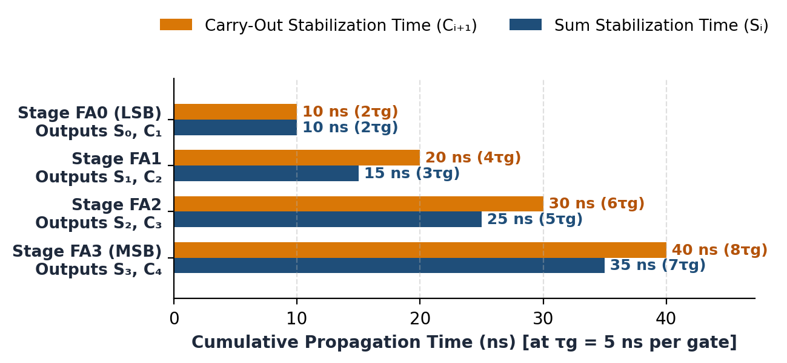
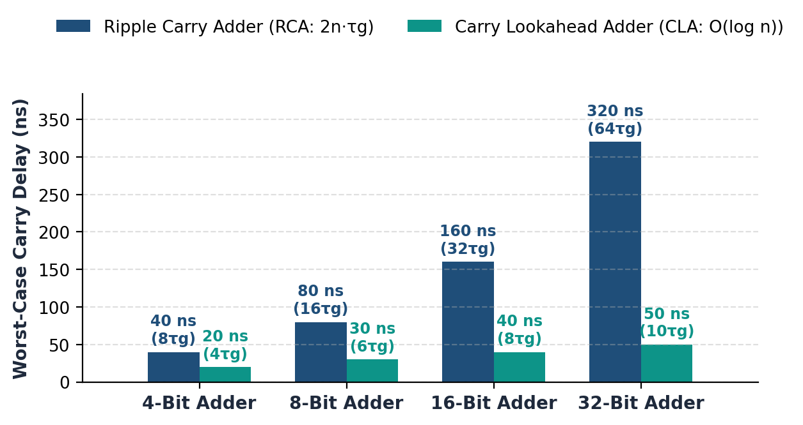

# ⚡ 4-Bit Ripple Carry Adder – Combinational Circuit Design & Delay Analysis
Construct a 4-bit Ripple Carry Adder using four cascaded Full-Adder stages. Study how carry propagates from one stage to the next and analyze the effect of carry propagation on circuit delay.

<p align="center">
  **A Digital Logic Mini Project | Computer Organization**
</p>

<p align="center">
  
  
  
  
  
  
</p>

---

## 📌 Project Overview

This project presents the design, implementation, and verification of a **4-Bit Ripple Carry Adder (RCA)** using four cascaded Full-Adder stages.

The circuit adds two 4-bit binary numbers, A (A₃A₂A₁A₀) and B (B₃B₂B₁B₀), along with an initial carry input (C₀), and produces a 5-bit result consisting of four sum bits and a final carry-out (C₄).

The project includes:

- Mathematical and Boolean formulation of a Full Adder.
- Gate-level design using XOR, AND, and OR gates.
- Four-stage ripple carry architecture.
- Virtual breadboard implementation using Autodesk Tinkercad.
- Interactive step-by-step web-based circuit simulator.
- Carry propagation and circuit delay analysis.

## 🎯 Project Objectives

1. Design a 4-bit Ripple Carry Adder using four Full-Adder stages.
2. Understand the operation of each 1-bit Full Adder.
3. Study how carry propagates from FA0 to FA3.
4. Verify Carry Generate, Carry Propagate, and Carry Kill conditions.
5. Analyze the effect of carry propagation on circuit delay.
6. Compare Ripple Carry Adder delay with Carry Lookahead Adder architecture.

## ⚙️ Circuit Architecture

The adder accepts two 4-bit inputs and one initial carry input:

- Input A = A₃ A₂ A₁ A₀
- Input B = B₃ B₂ B₁ B₀
- Initial Carry = C₀
- Output = C₄ S₃ S₂ S₁ S₀

**Full Adder Equations:**

For each stage i:

- Propagate: Pᵢ = Aᵢ ⊕ Bᵢ
- Generate: Gᵢ = Aᵢ · Bᵢ
- Sum: Sᵢ = Pᵢ ⊕ Cᵢ
- Carry-out: Cᵢ₊₁ = Gᵢ + (Pᵢ · Cᵢ)

The carry connection is cascaded as follows:

- FA0 produces C₁, which becomes the carry input of FA1.
- FA1 produces C₂, which becomes the carry input of FA2.
- FA2 produces C₃, which becomes the carry input of FA3.
- FA3 produces the final carry-out C₄.

### Full Adder Gate Implementation

| Gate | Quantity per Full Adder | IC |
|---|---:|---|
| XOR | 2 | 74HC86 |
| AND | 2 | 74HC08 |
| OR | 1 | 74HC32 |

For four Full-Adder stages, the complete design uses 8 XOR gates, 8 AND gates, and 4 OR gates (20 logic gates in total).

## 🔌 Hardware Implementation

The circuit was constructed as four cascaded Full-Adder stages across four breadboards, using a regulated +5V supply.

**Hardware Components (as documented in the project report):**

| Component | Specification | Quantity |
|---|---|---:|
| XOR Gate IC | 74HC86 | 4 |
| AND Gate IC | 74HC08 | 4 |
| OR Gate IC | 74HC32 | 4 |
| Voltage Regulator | 7805 | 1 |
| DC Battery | 9V | 1 |
| Slide Switches | Input controls | 9 |
| LEDs | 4 Sum + 1 Carry-Out | 5 |
| Breadboards | Solderless | 4 |

The 7805 voltage regulator provides a regulated +5V supply. Nine input switches control A₃–A₀, B₃–B₀, and C₀. Five LEDs display S₀–S₃ and the final carry-out C₄.

## 📸 Project Screenshots

### Complete 4-Bit Ripple Carry Adder Circuit


### Carry Propagation Delay Analysis


### Ripple Carry Adder vs Carry Lookahead Adder


## 💻 Step-by-Step Web-Based Circuit Simulator

A standalone interactive web application is included to demonstrate the construction and operation of the Ripple Carry Adder.

**Simulator Features (as present in the supplied HTML project):**

- Step-by-step circuit construction.
- Individual Full-Adder stage selection.
- Full-Adder internal gate-level visualization.
- Four-stage cascading demonstration.
- Carry ripple connection visualization.
- Interactive binary input controls.
- Sum and carry output display.
- Circuit wiring and pin-connection guidance.

### Technologies Used

| Technology | Application |
|---|---|
| HTML5 | Webpage structure |
| CSS3 / Tailwind CSS | User interface styling |
| JavaScript | Circuit logic and interaction |
| SVG | Circuit and gate visualization |
| Autodesk Tinkercad | Virtual breadboard implementation |
| PDF | Project report and simulator documentation |

## 📊 Carry Propagation and Delay Analysis

The project report models the carry path as two gate delays per Full-Adder stage.

For a 4-bit Ripple Carry Adder:

\[
T_{RCA}=2n\tau_g=8\tau_g
\]

For n = 4 and gate delay τg = 5 ns:

\[
T_{RCA}=8\times5=40\text{ ns}
\]

The modeled carry-out stabilization times are:

| Stage | Carry Output | Stabilization Time |
|---|---|---:|
| FA0 | C₁ | 10 ns (2τg) |
| FA1 | C₂ | 20 ns (4τg) |
| FA2 | C₃ | 30 ns (6τg) |
| FA3 | C₄ | 40 ns (8τg) |

**Key Observation:** The carry signal must pass through successive Full-Adder stages. Therefore, the worst-case propagation delay increases linearly with the number of stages, represented by O(n).

## 🧪 Carry Propagation Conditions

The project studies three carry conditions:

- **Carry Generate:** Aᵢ = 1 and Bᵢ = 1; the stage generates a carry.
- **Carry Propagate:** Pᵢ = Aᵢ ⊕ Bᵢ = 1; an incoming carry is propagated.
- **Carry Kill:** A stage does not pass an incoming carry to its output.

These conditions help explain why some input combinations produce a longer carry ripple path than others.

## 🚀 Run Locally

1. Download or clone this repository.
2. Open the project directory:

```bash
cd 4-Bit-Ripple-Carry-Adder-main
```

3. Open `index.html` in a web browser.

The supplied simulator is a standalone HTML file. No Python package installation or build process is required to open it.

The original simulator file is also available inside the `simulator/` folder.

## 📈 Results and Discussion

The project demonstrates a four-stage 4-bit Ripple Carry Adder using cascaded Full-Adder circuits.

- Four Full-Adder stages perform 4-bit binary addition.
- Each stage produces one sum bit and a carry-out.
- The carry-out of one stage is connected to the next stage.
- The modeled worst-case carry path is 8 gate delays.
- At τg = 5 ns, the modeled 4-bit carry propagation delay is 40 ns.
- The delay increases linearly as more stages are cascaded.

## 🔮 Future Scope

The project can be extended in several ways:

- Design of 8-bit, 16-bit, and 32-bit Ripple Carry Adders.
- Implementation of Carry Lookahead Adders.
- Comparison of different fast-adder architectures.
- FPGA-based implementation.
- Hardware timing measurement using suitable digital test equipment.
- Integration into a larger Arithmetic Logic Unit (ALU).

## 📚 References

1. M. Morris Mano, *Computer System Architecture*, 3rd Edition, Pearson Education.
2. M. Morris Mano and Michael D. Ciletti, *Digital Design*, 6th Edition, Pearson.
3. Carl Hamacher et al., *Computer Organization and Embedded Systems*, 6th Edition, McGraw-Hill.
4. William Stallings, *Computer Organization and Architecture: Designing for Performance*, 11th Edition, Pearson.
5. Texas Instruments, 74HC86, 74HC08, and 74HC32 Logic IC Datasheets.

## 👥 Project Team

**Department of Computer Science & Engineering**

Budge Budge Institute of Technology (BBIT)

| Team Member | Roll Number |
|---|---|
| MORIYAM KHATUN | 27600125048 |
| UPASANA SAMANTA | 27600125049 |
| SK MD FIRDOSE ALAM | 27600125050 |
| SHREYA MANDAL | 27600125051 |
| MASUD MOLLA | 27600125052 |

**Project Guide:** Dr. Raj Kumar Paul

**Head of Department:** Prof. Sagar Chakraborty

**Semester:** 3rd – Computer Organization

**Academic Year:** 2026–2027

## 📄 License

This project is distributed under the MIT License. See the [LICENSE](LICENSE) file for details.

---

<p align="center">
  **Developed as a Computer Organization Mini Project**
</p>

<p align="center">
  Made with dedication by the CSE Project Team.
</p>
